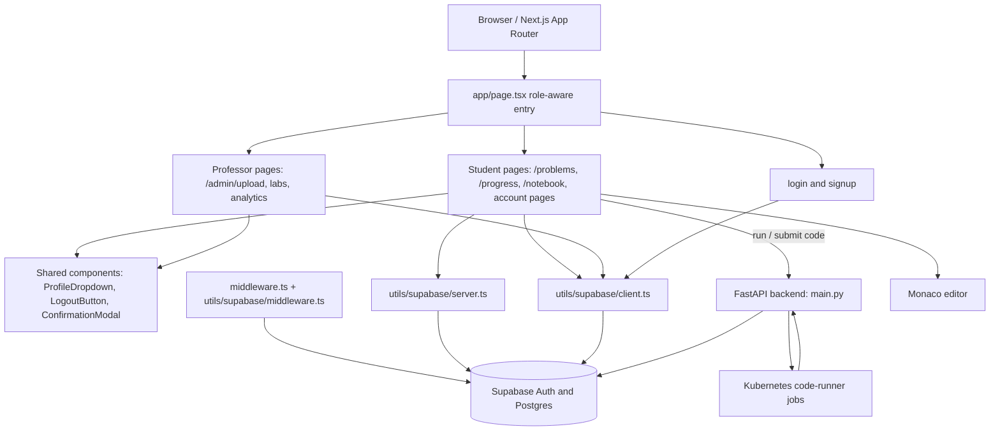

# Devora frontend inventory and architecture

This document maps the current UI and architecture in `oelp-frontend`, including student and professor surfaces.

## At a glance

- **Framework:** Next.js 14 App Router, React 18, TypeScript.
- **Styling:** Tailwind CSS (via `@tailwindcss/postcss`) plus page-level utility classes in JSX; global defaults are in `app/globals.css`.
- **UI libraries:** Monaco Editor for the coding workspace, React Markdown / GFM for problem descriptions, `lucide-react` and inline SVG icons.
- **Authentication/data:** Supabase Auth and database through browser/server clients in `utils/supabase/`.
- **Role selection:** The signup UI offers Student and Professor. Professor signup additionally asks for a faculty passcode. The root page checks the signed-in user's role and redirects to the relevant dashboard.
- **Visual direction today:** Student surfaces mostly use a dark charcoal/navy style; professor management surfaces mostly use white/light gray. Login and signup use a dark theme. Global CSS also declares dark-mode variables, while individual routes set many colors directly.

## Route inventory

### Shared entry and account routes

| Route | UI and purpose |
|---|---|
| `/` | Server entry point; resolves the current user and redirects to a role dashboard, otherwise shows a brief redirect/loading state. |
| `/login` | Dark sign-in form with email/password, Google and Microsoft (Outlook) sign-in options, error state, and link to account creation. |
| `/signup` | Dark registration form with role selector (Student/Professor), email/password, Google option; faculty passcode field appears for Professor. |
| `/auth/callback` | Auth callback endpoint used to complete the Supabase sign-in flow; no page UI. |
| `/profile` | Edit profile: username, avatar color or uploaded image, profile badge, and password update. |
| `/settings` | Account information (email and user ID) plus a danger zone for account deletion with typed-email confirmation. |
| `/appearance` | Appearance settings page; currently presents the Devora Dark theme. |

### Student surfaces

| Route | UI and purpose |
|---|---|
| `/problems` | Student dashboard. Top bar with Devora brand, leaderboard link and profile dropdown; summary cards for attempted, completed and available labs; lab cards show description, question count and completion progress. |
| `/problems/[labId]` | Lab detail: lab heading, back-to-labs link, and question list with titles and links into individual challenges. |
| `/problems/[labId]/[questionId]` | Coding workspace. Problem description pane, Monaco editor, language/file indicator, reset control, Run and Submit actions, input/expected-output examples, and per-test result/output feedback. Code drafts are saved locally per user/question. |
| `/problems/leaderboard` | Global student leaderboard with rank, student, progress and score. |
| `/progress` | Progress dashboard with streak and rank indicators, solved counts/progress grouped by difficulty (Easy/Medium/Hard), and recommended tasks. |
| `/notebook` | Personal notes workspace: note list, create/select note, title and body editor. |
| `/lists` | “My Lists” page. Current implementation is a sparse/placeholder surface. |
| `/playgrounds` | “My Playgrounds” page. Current implementation is a sparse/placeholder surface. |
| `/points` | Devora Points Store page. Current implementation is a sparse/placeholder surface. |
| `/orders` | “My Orders” page. Current implementation is a sparse/placeholder surface. |
| `/features` | “Try New Features” page. Current implementation is a sparse/placeholder surface. |

The profile dropdown is shared with the professor area and is the main navigation entry to profile/account-related routes. The student dashboard explicitly links to the global leaderboard.

### Professor surfaces

| Route | UI and purpose |
|---|---|
| `/admin/upload` | Professor lab dashboard (despite the route name, it is not just an upload form). Light top bar with LabAdmin brand, profile dropdown and Global Analytics link. New Lab Section form; Active Sections cards show question count and creation date, with Manage, Analytics and delete actions. Delete uses a confirmation modal. |
| `/admin/labs/[labId]` | Lab management page: lab heading, question list, empty state, create-question entry point and question deletion confirmation. |
| `/admin/labs/[labId]/create-question` | Challenge authoring form: title, Markdown-supported description, difficulty, points, and test-case input/output file pairs. Test cases can be marked public samples or hidden tests. |
| `/admin/Analytics` | Global analytics dashboard with summary statistic cards and a student leaderboard (rank, student, progress, score, last active and details). Supports lab selection/filtering. |
| `/admin/Analytics/[studentId]` | Student profile/analytics detail with total submissions and a submission list. |
| `/admin/Analytics/[studentId]` — `SubmissionList.tsx` | Client-side submission-list UI used by the student detail page. |
| `/admin/Analytics` — `LabSelector.tsx` | Lab filter control used by analytics. |

## UI and component architecture



### How the pieces fit

1. **Routing and rendering:** `app/` is the Next.js App Router tree. The root route resolves role-based navigation; dashboard/analytics pages include server-rendered data reads, while interactive forms, editor, profile and lab-management flows use client components.
2. **Auth and role-specific navigation:** Supabase auth is initialized through the server and browser helpers. `middleware.ts` delegates session refresh to the Supabase middleware helper. Signup captures a role and professor passcode; `/` routes a signed-in person to the matching dashboard.
3. **Student work flow:** Student pages read labs and progress from Supabase. The question workspace uses Monaco and calls the FastAPI service to run custom/sample input or submit against all test cases. The service executes jobs in Kubernetes and persists submission/progress data in Supabase (backend architecture summarized in the repository README).
4. **Professor authoring and review:** Professor pages read/write lab sections, questions and test cases through the browser Supabase client. Analytics pages read student/submission aggregates and provide links into per-student detail.
5. **Shared UI:** `ProfileDropdown`, `LogoutButton`, and `ConfirmationModal` live in `app/component/`; Supabase clients are in `utils/supabase/`. `app/layout.tsx` provides the global document shell and metadata; `app/globals.css` supplies base CSS.

## Source map

```text
oelp-frontend/
├── app/
│   ├── page.tsx                         role-aware entry
│   ├── layout.tsx, globals.css          global shell and styles
│   ├── login/, signup/                  authentication
│   ├── problems/                        student labs, challenge workspace, leaderboard
│   ├── progress/, notebook/             student progress and notes
│   ├── profile/, settings/, appearance/  account surfaces
│   ├── lists/, playgrounds/, points/, orders/, features/
│   ├── admin/upload/                    professor lab dashboard
│   ├── admin/labs/[labId]/              lab management and question authoring
│   ├── admin/Analytics/                 analytics and student detail
│   ├── component/                       shared UI components
│   └── auth/callback/                   auth callback handler
├── utils/supabase/                      browser, server, and middleware clients
└── middleware.ts                        route/session middleware
```

## Screenshot note

I started the existing frontend locally and confirmed the root route redirects to `/login`; the login screen is visible in the local browser. Student and professor dashboards are authenticated and data-backed, so capturing their actual screens requires a valid account/session and seeded records. I did not enter credentials, create an account, or alter app data. The account-gated screens are therefore documented from their route components rather than represented with invented screenshots.

## Design-rework reference notes

- The role split is primarily a route and navigation split; the global layout does not currently define a reusable role-specific shell.
- The main coding surface has a distinct IDE layout and dark palette; treat it as a focused workspace rather than a normal dashboard page.
- Student and professor areas currently have different visual systems (dark student surfaces versus light professor management). A redesign should decide whether to unify shared primitives while retaining role-specific information hierarchy.
- Several account-adjacent routes exist but are sparse/placeholder pages; distinguish implemented flows from established, data-rich surfaces when planning the redesign.
