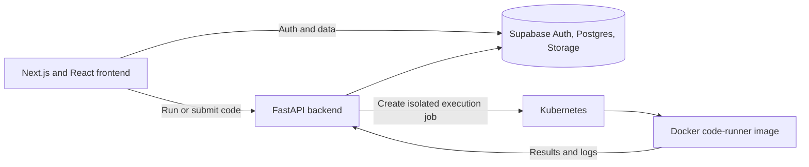

# Devora

Devora is a browser-based coding and learning platform for students and professors. Students work through programming labs in an in-browser editor, run and submit solutions, track progress, and compare scores on a leaderboard. Professors create labs and questions, upload test cases, and review student performance.

## Features

### Students

- Sign in with Supabase Auth, including configured Google and Microsoft OAuth providers.
- Browse labs and questions, then solve them in the Monaco code editor.
- Run code with custom input or submit it against a question's test cases.
- Review scores and test results, track progress, and view the leaderboard.
- Use profile, settings, notebook, and other account and learning pages.

### Professors

- Create and manage lab sections and programming questions.
- Set question difficulty and points, and add sample or hidden test cases.
- Review lab and student analytics, including submission history.

## Architecture



The frontend lives in `oelp-frontend/`. The FastAPI service is `main.py`. `Dockerfile` builds the code-runner image used for submitted programs. The backend uses the configured Kubernetes context to create isolated execution jobs; Minikube is suitable for local development.

See [FRONTEND_UI_INVENTORY.md](FRONTEND_UI_INVENTORY.md) for the route-by-route student and professor UI inventory and component architecture.

## Technology

- **Frontend:** Next.js 14 App Router, React 18, TypeScript, Tailwind CSS, Monaco Editor
- **Backend:** FastAPI, Python, Kubernetes Python client
- **Execution:** Docker image and Kubernetes jobs
- **Auth and data:** Supabase Auth, Postgres, and Storage

## Run locally

### Prerequisites

- Node.js 18 or later and npm
- Python 3.8 or later
- Docker Desktop or Docker Engine
- `kubectl` and a running Kubernetes cluster (Minikube is supported)
- A Supabase project configured for this app

### 1. Configure environment variables

Create a `.env` file in the repository root for the backend and a `.env.local` file in `oelp-frontend/` for Next.js. Use your own Supabase project values:

```dotenv
# Root .env (backend)
NEXT_PUBLIC_SUPABASE_URL=https://YOUR_PROJECT.supabase.co
SUPABASE_SERVICE_ROLE_KEY=YOUR_SERVER_ONLY_SERVICE_ROLE_KEY
PROFESSOR_SECRET_CODE=SET_A_PRIVATE_RANDOM_CODE
```

```dotenv
# oelp-frontend/.env.local
NEXT_PUBLIC_SUPABASE_URL=https://YOUR_PROJECT.supabase.co
NEXT_PUBLIC_SUPABASE_ANON_KEY=YOUR_SUPABASE_ANON_KEY
SUPABASE_SERVICE_ROLE_KEY=YOUR_SERVER_ONLY_SERVICE_ROLE_KEY
```

The service-role key and professor code are secrets. Keep them server-side, do not use a `NEXT_PUBLIC_` prefix for them, and never commit real environment files. The backend accepts the legacy `NEXT_PUBLIC_SUPABASE_SERVICE_ROLE_KEY` and `NEXT_PUBLIC_PROFESSOR_CODE` names for existing local setups, but new deployments should use the server-only names above.

Configure the Supabase tables, policies, OAuth providers, and `lab-files` Storage bucket required by your deployment. Supabase Row Level Security policies should restrict student and professor access to the appropriate records.

### 2. Build the code-runner image

From the repository root:

```bash
docker build -t coderunner:latest .
minikube image load coderunner:latest
```

If you use a different cluster, make the `coderunner:latest` image available to its nodes and configure `kubectl` to use that cluster.

### 3. Start the backend

From the repository root:

```bash
python -m venv .venv
# Windows PowerShell:
.\.venv\Scripts\Activate.ps1
# macOS / Linux:
# source .venv/bin/activate

pip install fastapi uvicorn kubernetes supabase python-dotenv
uvicorn main:app --host 127.0.0.1 --port 8000
```

The API health endpoint is `http://127.0.0.1:8000/`.

### 4. Start the frontend

In a second terminal:

```bash
cd oelp-frontend
npm install
npm run dev
```

Open [http://localhost:3000](http://localhost:3000).

## Main routes

| Route | Purpose |
|---|---|
| `/landing.html` | Devora landing page |
| `/login`, `/signup` | Authentication and account creation |
| `/problems` | Student labs dashboard |
| `/problems/[labId]` | Lab questions |
| `/problems/[labId]/[questionId]` | Coding workspace |
| `/problems/leaderboard`, `/progress` | Student leaderboard and progress |
| `/admin/upload` | Professor lab dashboard |
| `/admin/labs/[labId]` | Lab and question management |
| `/admin/Analytics` | Professor analytics |
| `/profile`, `/settings`, `/appearance`, `/notebook` | Account and learning tools |

## License

This project is licensed under the MIT License. See [LICENSE](LICENSE).
